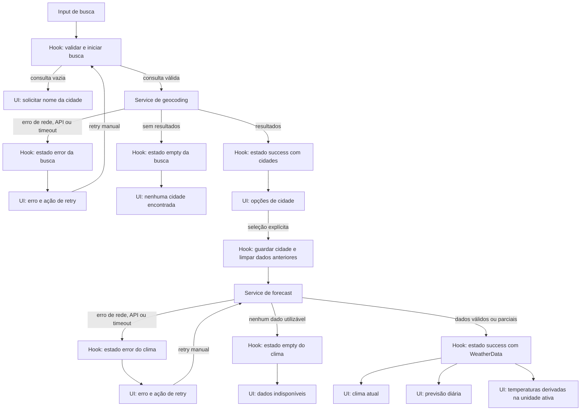

# Weather App — Plano Técnico

Fonte da verdade: [especificação do produto](../specs/weather-app-spec.md). Este documento define decisões, limites entre módulos e contratos; não é a implementação final.

## Architecture

Aplicação cliente-renderizada, sem servidor próprio, organizada em quatro camadas com dependências em uma direção: `components` → `hooks` → `services` → Open-Meteo; `hooks` e `components` também podem usar funções puras de `lib`. A camada `lib` não depende de React, rede ou estado. Os contratos compartilhados ficam em `types`.

A busca de cidade e a consulta meteorológica são operações distintas. Selecionar um resultado explícito inicia uma nova consulta; não há seleção automática. Os dados meteorológicos atuais e diários são normalizados e apresentados separadamente, para que a indisponibilidade de uma seção não apague a outra. Uma falha de transporte da consulta meteorológica afeta a resposta inteira; campos ausentes em uma resposta válida afetam somente a seção ou o campo correspondente.

Não haverá roteador, camada de domínio genérica, estado global externo ou cache próprio: o fluxo de uma única tela não justifica essas abstrações.

## Tech Stack

- TypeScript em modo strict, React 19 e Vite, conforme a stack do repositório.
- Tailwind CSS para interface responsiva e acessível; manter a configuração existente.
- `fetch` nativo para Open-Meteo; nenhuma chave de API, backend ou dependência de cliente HTTP.
- Vitest, Testing Library e jsdom para testes unitários e de componentes; Playwright para E2E.
- Biome para lint e formatação; pnpm como gerenciador de pacotes.
- Sem biblioteca adicional de estado. Para a varredura automatizada WCAG exigida pela spec, adicionar `@axe-core/playwright` como dependência de desenvolvimento quando a suíte E2E for implementada.

## Project Structure

Estrutura alvo dentro de `src/`, seguindo as convenções do repositório:

```text
src/
  components/
    CitySearch.tsx        # entrada, submissão, feedback da busca e lista de resultados
    CityResult.tsx        # apresentação acessível e seleção de uma cidade
    CurrentWeather.tsx    # apresentação isolada da seção atual
    DailyForecast.tsx     # cinco dias e campos indisponíveis
    TemperatureUnit.tsx   # controle de unidade, sem lógica de conversão/rede
  hooks/
    useWeatherApp.ts      # estado da tela e orquestração das operações
  services/
    openMeteo.ts          # chamadas HTTP, validação e normalização dos payloads
  types/
    weather.ts            # tipos compartilhados de domínio e estados
  lib/
    format.ts             # funções puras de data, temperatura e condição

tests/
  unit/                   # regras puras e serviço
  components/             # apresentação, estados e acessibilidade
  e2e/                    # fluxos integrados e viewports
```

`components` cuida da renderização e interação dos controles. Recebe estados, dados e callbacks tipados; não importa `services`, não inicia `fetch` e não decide regras de negócio. `CitySearch` apresenta consulta, feedback e resultados, delegando submissão/seleção por callbacks. `CurrentWeather` e `DailyForecast` são independentes para que dados atuais válidos permaneçam visíveis quando a previsão estiver indisponível.

`useWeatherApp` mantém busca, cidade selecionada, dados meteorológicos e unidade; orquestra busca, seleção, retry e alternância de unidade; controla cancelamento, concorrência e timeout; e expõe dados e handlers à composição dos componentes. Não duplica parsing de payload ou cálculos de formatação.

`services/openMeteo.ts` é a única camada que conhece URLs, parâmetros e formato JSON da Open-Meteo. Executa requisições e traduz respostas para tipos de domínio, sem estado de UI ou persistência. `lib/format.ts` contém cálculos determinísticos sem efeitos colaterais, como conversão de temperatura, formatação pt-BR, tradução de código WMO e datas locais. `types/weather.ts` mantém os contratos compartilhados fora dos formatos externos.

Essa separação facilita testes no menor nível adequado: testar `lib` com entradas e saídas sem React/rede; testar o serviço mockando `fetch` e inspecionando URL, parâmetros, parsing e falhas; testar o hook mockando o serviço para concorrência e estados; testar componentes com props fornecidas pela Testing Library; e reservar E2E para os fluxos integrados, acessibilidade e responsividade. Os nomes são uma proposta de organização, não uma exigência de criar cada arquivo nesta fase do plano.

## Data Model

Interfaces de domínio normalizadas a partir do geocoding e forecast da Open-Meteo; não expõem diretamente o JSON do provedor. Campos meteorológicos permanecem em Celsius, mesmo quando a interface está em Fahrenheit.

```ts
export type Unit = 'celsius' | 'fahrenheit';

export interface City {
  id: string; // Identificador estável local, derivado dos dados do resultado.
  name: string; // Nome da localidade retornado pelo geocoding.
  country: string | null; // País, quando fornecido.
  administrativeArea: string | null; // Região administrativa (admin1), quando fornecida.
  latitude: number; // Latitude usada na consulta meteorológica.
  longitude: number; // Longitude usada na consulta meteorológica.
  timezone: string | null; // Fuso IANA do resultado, quando fornecido.
}

export interface CurrentWeather {
  time: string | null; // Horário local da observação, quando fornecido.
  temperatureC: number | null; // temperature_2m normalizada para Celsius.
  weatherCode: number | null; // weather_code WMO usado para obter a descrição localizada.
}

export interface ForecastDay {
  date: string; // Data local no formato YYYY-MM-DD.
  weatherCode: number | null; // weather_code WMO para o dia.
  temperatureMinC: number | null; // temperature_2m_min em Celsius.
  temperatureMaxC: number | null; // temperature_2m_max em Celsius.
}

export interface WeatherData {
  city: City; // Cidade selecionada à qual estes dados pertencem.
  timezone: string | null; // Fuso retornado pelo endpoint de forecast.
  current: CurrentWeather | null; // Condições atuais, independentemente da previsão.
  forecast: ForecastDay[] | null; // Cinco datas locais; null quando a seção está indisponível.
}

type RequestErrorReason = 'network' | 'api' | 'timeout';

type SearchState =
  | { status: 'idle' }
  | { status: 'loading'; query: string }
  | { status: 'success'; query: string; cities: City[] }
  | { status: 'empty'; query: string }
  | { status: 'error'; query: string; reason: RequestErrorReason };

type WeatherState =
  | { status: 'idle' }
  | { status: 'loading'; city: City }
  | { status: 'success'; data: WeatherData }
  | { status: 'empty'; city: City }
  | { status: 'error'; city: City; reason: RequestErrorReason };
```

`City.id` é uma chave estável derivada dos campos geográficos fornecidos pelo provedor, não uma identificação persistida. Os valores meteorológicos são sempre armazenados em Celsius; conversão para Fahrenheit ocorre na apresentação, evitando arredondamentos acumulados e nova consulta ao trocar unidade. `weatherCode` é traduzido por uma função pura para uma descrição pt-BR; código desconhecido ou ausente resulta em condição indisponível, nunca em texto inventado.

A normalização sempre conserva a identidade da cidade selecionada. Se faltarem campos da resposta, conserva os valores válidos e usa `null` para os indisponíveis. A previsão é preenchida com cinco datas locais consecutivas; medições ausentes permanecem `null`. Se não for possível estabelecer as datas locais, a seção inteira fica `null`.

## Data Flow

1. A tela inicia sem cidade, em Celsius e com as operações em `idle`; nenhum estado é restaurado entre carregamentos completos.
2. Ao submeter a busca, remover somente espaços externos. Entrada vazia não chama serviço. Para uma entrada válida, mostrar loading e consultar geocoding; exibir no máximo os cinco primeiros resultados, na ordem recebida.
3. Ao selecionar um resultado, guardar a cidade em memória, limpar dados meteorológicos da seleção anterior e consultar a previsão para as coordenadas selecionadas. Não reutilizar resposta anterior.
4. Normalizar e exibir clima atual e previsão independentemente. Valores ausentes viram indisponíveis; a previsão representa hoje e os quatro dias seguintes no fuso local retornado pela API.
5. A alternância de unidade atualiza somente a apresentação das temperaturas, preservando cidade, datas e resposta carregada.
6. Em uma nova busca, abortar a busca anterior e associar cada operação a um identificador crescente. Só a operação ainda vigente pode alterar estado, mesmo se o provedor concluir uma resposta após o cancelamento.
7. A retentativa repete manualmente a operação que falhou, com a mesma consulta ou cidade. Não há retentativa automática.



## External APIs

Usar os endpoints públicos da Open-Meteo diretamente do navegador, sem credenciais:

### Geocoding

- **URL:** `https://geocoding-api.open-meteo.com/v1/search`
- **Parâmetros:** `name` recebe a consulta aparada, preservando acentos e pontuação; `count=5` limita resultados; `language=pt` solicita nomes em português quando disponíveis; `format=json` explicita o formato.
- **Exemplo resumido de resposta:**

```json
{
  "results": [
    {
      "id": 3448439,
      "name": "São Paulo",
      "latitude": -23.5475,
      "longitude": -46.6361,
      "country": "Brazil",
      "country_code": "BR",
      "admin1": "São Paulo",
      "timezone": "America/Sao_Paulo"
    }
  ],
  "generationtime_ms": 0.2
}
```

- **Mapeamento para `City`:** `id` vira string e identifica a opção; `name` vira `name`; `country` vira `country`; `admin1` vira `administrativeArea`; `latitude` e `longitude` são preservadas; `timezone` vira o fuso da cidade. Campos geográficos textuais opcionais ausentes são normalizados para `null`. Usar os cinco primeiros resultados na ordem recebida. A API pode omitir `results` quando não há correspondências; normalizar isso como lista vazia, não como erro.

### Forecast

- **URL:** `https://api.open-meteo.com/v1/forecast`
- **Parâmetros:** `latitude` e `longitude` vêm da cidade selecionada; `current=temperature_2m,weather_code` solicita temperatura e condição atuais; `daily=weather_code,temperature_2m_min,temperature_2m_max` solicita condição e extremos diários; `forecast_days=5` solicita hoje e os quatro dias seguintes; `timezone=auto` pede horários/datas locais e o fuso da coordenada; `temperature_unit=celsius` mantém os dados canônicos em Celsius.
- **Exemplo resumido de resposta:**

```json
{
  "timezone": "America/Sao_Paulo",
  "current": {
    "time": "2026-10-27T14:00",
    "temperature_2m": 22.4,
    "weather_code": 2
  },
  "daily": {
    "time": ["2026-10-27", "2026-10-28", "2026-10-29", "2026-10-30", "2026-10-31"],
    "weather_code": [2, 3, 61, 2, 0],
    "temperature_2m_min": [17.1, 16.8, 18.0, 17.5, 16.2],
    "temperature_2m_max": [25.3, 24.7, 22.1, 26.0, 27.2]
  }
}
```

- **Mapeamento para `WeatherData`:** associar a cidade selecionada em `city` e `timezone` à propriedade `timezone`. Mapear `current.time`, `current.temperature_2m` e `current.weather_code` para `CurrentWeather.time`, `temperatureC` e `weatherCode`. As propriedades de `daily` são arrays paralelos: para cada índice `i`, criar um `ForecastDay` com `date=daily.time[i]`, `weatherCode=daily.weather_code[i]`, `temperatureMinC=daily.temperature_2m_min[i]` e `temperatureMaxC=daily.temperature_2m_max[i]`. Validar comprimentos e valores; campos ausentes viram `null`, sem substituir por zero. Gerar as cinco datas no fuso local da cidade; se não for possível determiná-las, mapear `forecast` como `null`.

Contratos internos do serviço:

```ts
searchCities(query: string, signal: AbortSignal): Promise<City[]>;
getWeather(city: City, signal: AbortSignal): Promise<WeatherData>;
```

O serviço traduz o JSON externo para os tipos de domínio e valida campos necessários antes de expô-los à UI. Lista vazia é sucesso, não erro. Falhas de rede, HTTP/provedor, formato inválido e timeout são falhas tipadas ou distinguíveis para a interface. Toda requisição tem limite de 10 segundos; cancelamento por operação substituída não deve ser apresentado como erro ao usuário.

Sem cache de aplicação: usar requisições sem reutilização de cache HTTP pelo cliente (`cache: 'no-store'`) e não persistir respostas em storage. Mostrar atribuição visível com link para Open-Meteo. Validar termos, atribuição, limites de uso e cobertura antes da publicação, conforme OQ-02 da spec.

## State Management

O estado da tela vive em `useWeatherApp`, com `useState` local: consulta digitada, `SearchState`, cidade selecionada, `WeatherState` e `Unit`. Componentes recebem valores e callbacks por props; não há store global, URL state ou persistência. A consulta permanece disponível após busca vazia ou falha. Sem cidade selecionada, o estado meteorológico é `idle`.

Busca e meteorologia têm estados discriminados independentes: `idle` (operação não iniciada/sem seleção), `loading` (requisição pendente), `success` (dados utilizáveis), `empty` (busca válida sem resultados ou resposta meteorológica válida sem dados utilizáveis) e `error` (falha de rede, API ou timeout). Resposta meteorológica parcial continua em `success` quando ao menos uma seção tem dados; campos/seções ausentes são representados por `null` e apresentados como indisponíveis. Isso evita que o estado da previsão esconda condições atuais válidas.

`Unit` também vive no hook, inicializada como `'celsius'` a cada carregamento completo. A resposta é mantida em Celsius; a renderização deriva cada valor com uma função pura: Celsius retorna o valor original e Fahrenheit calcula `C × 9/5 + 32`. Em seguida, formatar com uma casa decimal, vírgula decimal pt-BR e símbolo `°C` ou `°F`. Valores `null` continuam indisponíveis. Alterar a unidade atualiza somente a apresentação: não modifica `WeatherData`, não muda cidade/data e não chama o serviço.

Busca concorrente: `AbortController` cancela a operação substituída e um identificador de requisição impede que respostas obsoletas atualizem a tela. Seleção de outra cidade limpa imediatamente os dados meteorológicos anteriores; a resposta só pode ser aplicada à cidade/identificador que iniciou a operação. Cada requisição termina em até 10 segundos. Retry é acionado pelo usuário e repete a mesma consulta/cidade; não há retries automáticos.

## Error Handling

- **Rede:** falha de conexão, DNS ou `fetch` vira `error` com motivo `network`; mostrar mensagem localizada e retry manual da operação correspondente.
- **API:** resposta HTTP não bem-sucedida ou payload ilegível/incompatível vira `error` com motivo `api`. Geocoding sem resultados não é erro: define `SearchState` como `empty`, mantém a consulta e mostra “Nenhuma cidade encontrada”.
- **Timeout:** encerrar a operação em 10 segundos, definir `error` com motivo `timeout` e oferecer retry manual. Não há repetição automática.
- **Resposta parcial:** se o payload for válido e qualquer seção tiver dados utilizáveis, manter `WeatherState` em `success`; renderizar atual e previsão de forma independente e marcar campos/dias ausentes como indisponíveis. Não usar zero, interpolar ou inventar condições. Se nenhuma seção tiver dados utilizáveis, usar `empty` para a cidade selecionada e informar indisponibilidade.
- **Campos locais inválidos/ausentes:** condição WMO desconhecida ou ausente é indisponível. Preservar temperaturas válidas se faltar a condição e vice-versa. Se não for possível determinar o fuso/data local, marcar a previsão indisponível sem ocultar o clima atual válido.
- **Seleção e dados obsoletos:** em nova seleção, limpar os dados da cidade anterior. Não mostrar resposta associada a outra cidade.
- **Cancelamento concorrente:** cancelamento provocado por busca mais recente ou desmontagem não é erro visível; ignorar resultado tardio. Somente a operação vigente pode atualizar estado.
- Mensagens de loading, sucesso e erro devem ser anunciadas com semântica acessível (por exemplo, regiões `aria-live`) sem roubar o foco; controles e retentativas devem funcionar por teclado.

## Testing Strategy

- **Vitest — funções puras:** testar conversão Celsius/Fahrenheit (incluindo 0 °C e -40 °C), arredondamento/formatação pt-BR, tradução de códigos WMO, cálculo das cinco datas locais e preservação de valores ausentes. Esses testes não precisam de React nem de rede.
- **Vitest — services:** mockar `fetch` para geocoding e forecast. Cobrir parâmetros/URLs, encoding de consulta, ordem e limite de resultados, mapeamento dos arrays diários, respostas parciais, lista vazia, HTTP inválido, JSON malformado, falha de rede, timeout e cancelamento. Verificar `no-store` e que não há retry automático.
- **Vitest — hook e componentes:** com o serviço mockado, testar `idle`, `loading`, `success`, `empty` e `error`; incluir retry, cidade selecionada, dados parciais, mudança de unidade sem nova chamada e resposta antiga concluída depois da busca mais recente. Componentes devem ser renderizados via Testing Library com estados/props controlados, cobrindo textos, mensagens acessíveis, teclado e ações.
- **Playwright — E2E:** interceptar as APIs para testar busca → seleção explícita → dados atuais e previsão → alternância de unidade → retry. Incluir busca sem resultados, falhas/timeout e resposta parcial; usar relógio fixo para validar datas locais sem depender do dia da execução.
- **Playwright — responsividade mobile:** exercitar o fluxo central em 320×640 (retrato) e 640×320 (paisagem), verificando controles acessíveis, ausência de sobreposição e rolagem horizontal. Validar também os demais viewports da spec (768×1024, 1440×900 e 1920×1080) para preservar o baseline de AC-10/RNF-01.
- **Acessibilidade e gates:** executar axe-core nos estados relevantes, com zero violações críticas/sérias, e verificar manualmente foco visível e anúncios de estado. Para mudanças de código, rodar `pnpm lint`, `pnpm build` e `pnpm test`; rodar `pnpm test:e2e` quando o fluxo integrado for afetado. Desempenho p95 de 5 s e conclusão em até 10 s exigem teste sob as condições de rede da spec.

## Risks & Trade-offs

- **Dependência e cobertura do Open-Meteo:** indisponibilidade, limite, dados ausentes, cobertura geográfica ou mudança de termos afetam consultas. A aplicação mantém o shell disponível, expõe erro/indisponibilidade por seção e permite retry; validar OQ-02 antes de publicar.
- **Termos e atribuição:** os requisitos de publicação dependem da confirmação dos termos aplicáveis e da apresentação do crédito visível. Não presumir que a ausência de API key elimina restrições de uso.
- **Fuso e virada de data:** datas do provedor devem ser tratadas como datas-calendário locais (`YYYY-MM-DD`), não instantes UTC convertidos pelo fuso do navegador. Usar `timezone=auto` e o timezone retornado; se ausente, não inventar o dia local.
- **Ambiguidade geográfica:** limitar geocoding a cinco resultados mantém a busca simples, mas pode não expor toda cidade correspondente. Não selecionar automaticamente; mostrar país/região e, quando insuficientes para distinguir homônimos, coordenadas com duas casas.
- **Desempenho externo:** a meta p95 de 5 s depende de rede e provedor e não é garantida pela UI. O timeout de 10 s garante término visível, não sucesso; a medição de p95 deve usar as condições especificadas.
- **Escopo operacional:** disponibilidade mensal de 99,5% requer hospedagem e verificações sintéticas a cada cinco minutos, fora da lógica do cliente. Planejar essa configuração para publicação; não simular garantia no código da aplicação.
- **Metas pendentes de aprovação:** baseline de desempenho, disponibilidade, navegadores/viewports e regiões prioritárias dependem das decisões OQ-01/OQ-03. Manter estes limites como requisitos da spec até aprovação, sem alterá-los durante implementação.
- **Simplicidade versus isolamento:** uma requisição de forecast entrega condições atuais e diárias; a normalização por seção lida com ausência parcial sem duplicar chamadas. Falha de transporte exige nova consulta completa, enquanto dados válidos parciais continuam visíveis.

### Alternativas técnicas consideradas

- **Estado local no hook vs. Redux/Zustand:** escolher hook React evita dependência e boilerplate para uma única tela. Store global só se justifica se surgirem múltiplas telas ou consumidores independentes do mesmo estado.
- **`fetch` nativo vs. Axios/cliente HTTP:** `fetch` reduz dependências e atende aos dois endpoints; centralizar timeout, cancelamento e parsing em `services/openMeteo.ts` mantém esse tratamento consistente. Um cliente dedicado seria justificável com interceptors ou muitos serviços.
- **Sem cache vs. TanStack Query/cache próprio:** não armazenar resposta segue a exigência de buscar dados atuais a cada seleção/retry. O custo é repetir chamadas ao reconsultar a mesma cidade; cache só deve ser reconsiderado se a spec mudar.
- **Uma chamada Forecast vs. chamadas separadas para atual e diário:** a resposta única reduz coordenação e chamadas, e permite normalizar as seções independentemente. O trade-off é que uma falha de transporte afeta ambas; dados parciais no payload continuam sendo exibidos.
- **Celsius como modelo canônico vs. conversão no serviço:** manter Celsius no modelo evita duplicar dados e refazer requests ao trocar unidade; conversão/formatatação ocorre na renderização. A alternativa exigiria sincronizar duas representações ou consultar unidades diferentes.
- **Vitest focado + Playwright para integração vs. concentrar tudo em E2E:** testes de unidade/componentes são mais rápidos e localizam falhas; Playwright fica reservado para confirmar fluxos reais, layout mobile e acessibilidade integrada, reduzindo custo e flakiness.
